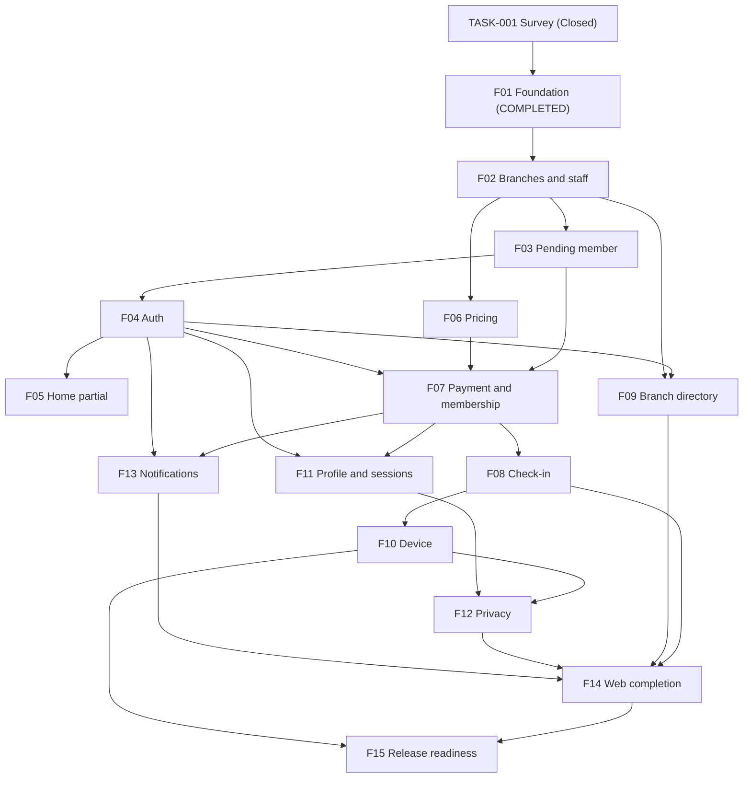

# GYMOS — Roadmap theo phụ thuộc

19/11/2026 · Đề xuất, không phải lịch cam kết. Nguồn [gymos.md](../../gymos.md) §8. Giữ 3 giai đoạn và Feature First đã chốt; chi tiết Fxx là phân rã Advisor, cần duyệt. Không có estimate hoặc sprint date khi repo chưa khảo sát.

| Giai đoạn | Thứ tự định hướng | Gate chuyển tiếp đề xuất |
|---|---|---|
| 1 — Sản phẩm cốt lõi | TASK-001 (COMPLETED) → F01 (COMPLETED) → F02 → F03 → F04 → F05 phần sẵn có; F06 → F07 → F08/F09; F11–F13 theo phụ thuộc; F10 thử tích hợp sớm | Luồng quầy mua lần đầu và App đăng nhập/gia hạn/check-in/hồ sơ vận hành được trong môi trường đã duyệt; ghi rõ giới hạn vendor và privacy |
| 2 — Vận hành chi nhánh | F14 và hoàn thiện các phần quầy theo F02/F03/F07/F08/F11/F12 | Quyền chi nhánh, báo cáo, ngoại lệ, UI quầy được kiểm thử; không mở rộng HQ/HR |
| 3 — Tích hợp và hoàn thiện | F10 và các tích hợp thật còn thiếu, F15 | Đã kiểm chứng ngân hàng/SMS/push/thiết bị thật, quyền riêng tư, backup/restore, bảo mật; Production chỉ sau duyệt riêng |

## Điều chỉnh có chủ đích so với thứ tự minh họa gốc

- Đưa dữ liệu chi nhánh, phân quyền vận hành và hồ sơ tối thiểu lên trước OTP vì App chỉ cho hội viên đã kích hoạt đăng nhập. Nếu dùng fixture ACTIVE để test auth trước mua lần đầu, phải duyệt riêng cách tạo dữ liệu test; không tạo cơ chế kích hoạt production giả.
- Trang chủ triển khai theo dữ liệu thật đã có, hoàn thiện khi thanh toán/check-in/chi nhánh/thông báo sẵn sàng.
- Khảo sát vendor ngân hàng, SMS, thiết bị và yêu cầu xóa dữ liệu từ sớm, không chờ giai đoạn 3; không cài SDK hay kết nối thật trước duyệt. F10 là nhóm thực thi/kiểm chứng riêng, không phải chờ tới cuối mới xem khả năng tích hợp.
- Tích hợp thông báo, audit, data scope, bảo mật và tiêu chí xóa/cache từ các lát cắt liên quan, không để toàn bộ đến cuối. Các nhánh song song chỉ thực thi khi được duyệt; không mặc định cho phép nhiều task đồng thời.

## Quy trình mỗi lát cắt

Chốt phạm vi → khảo sát → kế hoạch P1/P2 (DB/API/UI/test, rủi ro, tài nguyên) → duyệt phạm vi và thao tác riêng → code → kiểm tra → báo cáo → HANDOFF/PROJECT_CONTEXT → đề xuất nhiệm vụ tiếp. Không tạo toàn bộ schema, UI hoặc hàng loạt task trước khi cần. Xem [backlog](FEATURE_BACKLOG.md).
