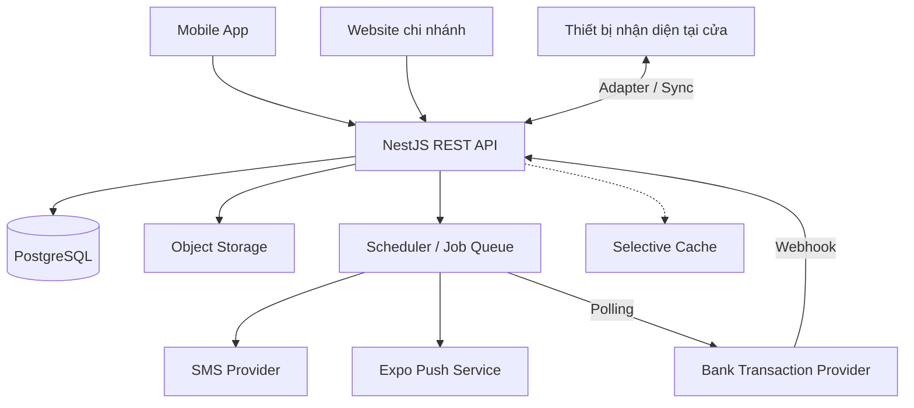
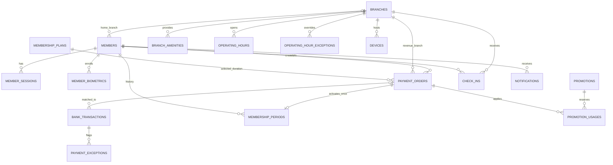

# GYMOS — Đặc tả sản phẩm và định hướng phát triển

**Phiên bản:** 1.0 (bản tổng hợp quyết định nghiệp vụ và thiết kế)<br>
**Ngày tổng hợp:** 19/11/2026 (Việt Nam)<br>
**Trạng thái:** Định hướng đã được thống nhất trong trao đổi; chưa xác minh repository hoặc triển khai mã nguồn.<br>
**Vai trò:** Người dùng quyết định; Advisor (ChatGPT) tư vấn; Coder (Antigravity) khảo sát, lập kế hoạch và thực thi sau phê duyệt.

## 0. Cách sử dụng tài liệu

Tài liệu này tập hợp Product Specification, Business Rules, System Architecture, Database Design, Mobile App Specification, Web App Specification, Design System và Development Roadmap trong một file Markdown.

- **Đã chốt:** quyết định được người dùng lựa chọn/chấp thuận trong trao đổi, có hiệu lực theo nội dung mới nhất.
- **Đề xuất:** cấu trúc, tên trường, chi tiết kỹ thuật hoặc phương án triển khai chưa được duyệt; Coder phải trình kế hoạch trước khi áp dụng.
- **Chưa chốt:** vấn đề cần xác minh hoặc quyết định, không tự điền giả định.
- Các bảng giá, tên chi nhánh, tên hội viên và dữ liệu ví dụ chỉ minh họa, không dùng làm seed production.
- Quyết định mới thay thế quyết định cũ khi mâu thuẫn. Những vấn đề chưa rõ không được tự giải quyết bằng cách chọn một phương án trong bản mô tả này.
- Đọc cùng `AGENT_RULES.md`. File này không cấp quyền sửa code, cài dependency, chạy migration, commit, push hay deploy.

**Nguồn tổng hợp:** `AGENT_RULES.md` (18/11/2026), `líchuchatgymos.txt` (lịch sử ý tưởng ban đầu), các quyết định tiếp theo trong cuộc trao đổi GYMOS đến 19/11/2026. Nội dung cũ được đối chiếu với các thay đổi mới. Chưa có `PROJECT_CONTEXT.md`, `HANDOFF.md` hoặc source repository được xác minh trong lần tạo tài liệu này.

## Mục lục

1. [Product Specification](#1-product-specification)
2. [Business Rules](#2-business-rules)
3. [System Architecture](#3-system-architecture)
4. [Database Design](#4-database-design)
5. [Mobile App Specification](#5-mobile-app-specification)
6. [Web App Specification](#6-web-app-specification)
7. [Design System](#7-design-system)
8. [Development Roadmap](#8-development-roadmap)
9. [Điểm chưa chốt và điều kiện nghiệm thu](#9-điểm-chưa-chốt-và-điều-kiện-nghiệm-thu)
10. [Quy tắc bàn giao Advisor–Coder](#10-quy-tắc-bàn-giao-advisorcoder)

---

## 1. Product Specification

### 1.1. Định vị — đã chốt

GYMOS là phần mềm quản lý hội viên và trải nghiệm tập luyện cho một chuỗi phòng Gym, không phải SaaS cho nhiều doanh nghiệp độc lập, không phải ERP.

- **Mobile First — Member Centric:** Mobile App cho hội viên là sản phẩm trọng tâm.
- **Automation First:** ưu tiên tự động thanh toán, kích hoạt, gia hạn, thông báo, kiểm tra quyền ra vào.
- **Self-service First:** hội viên tự thực hiện các nghiệp vụ được phép trên App.
- **Minimal Operations:** giảm thao tác cho nhân viên, kể cả lễ tân bán thời gian.
- **No Overengineering:** không xây chức năng hoặc abstraction cho nhu cầu chưa chốt.
- **Feature First:** phát triển từng nhóm chức năng theo chiều dọc Database → API → UI → kiểm thử.

### 1.2. Các nền tảng

| Nền tảng | Người dùng/phạm vi | Vai trò |
|---|---|---|
| Mobile App | Hội viên toàn chuỗi | Theo dõi thời hạn, gia hạn, check-in, chi nhánh, hồ sơ, bảo mật, thông báo |
| Website | Quản lý chi nhánh, lễ tân | Công cụ vận hành chi nhánh, đăng ký hội viên, hỗ trợ thanh toán và check-in, báo cáo doanh thu hội viên |
| Backend | Dùng chung toàn hệ thống | Nghiệp vụ, API, dữ liệu, bảo mật, tự động hóa, tích hợp |
| Thiết bị nhận diện | Cửa ra vào phòng Gym | Nhận diện khuôn mặt, kiểm tra quyền và mở cửa tự động |

Website không phải trang quản trị tổng công ty/toàn thương hiệu. Các cấu hình chung được thiết lập ngoài phạm vi Website chi nhánh; cơ chế thực hiện cấu hình chung chưa chốt. Nhân viên dùng phần mềm khác để quản lý nhân sự; GYMOS chỉ giữ tài khoản vận hành và phân quyền cần thiết.

### 1.3. Ngoài phạm vi hiện tại — đã chốt

- Quản lý nhân sự, hồ sơ lao động, ca làm việc, chấm công, lương, thưởng, hợp đồng, đánh giá nhân viên.
- ERP, kế toán, công nợ, chi phí, lợi nhuận, quản lý kho, bán nước/thực phẩm/quần áo/phụ kiện, hóa đơn điện tử, quy trình chốt sổ.
- Women Gym, Yoga, bơi lội, Cycling, Group X và phân hệ dịch vụ tập luyện chuyên biệt; chỉ tập trung Gym truyền thống.
- Phân hạng Basic/Premium/VIP, bán riêng tiện ích đi kèm, gói tùy chọn dịch vụ, theo dõi lượt sử dụng tiện ích.
- Tập thử miễn phí, hồ sơ tập thử, CRM khách hàng tiềm năng; không gói 0 đồng.
- Bảo lưu, chuyển nhượng, quy trình hủy/hoàn tiền tự động, thanh toán tiền mặt/trả góp.
- QR check-in, check-out, đo số người thực tế đang có mặt; không xây dựng hệ thống nhận diện khuôn mặt riêng bằng AI.
- Chat trực tiếp, ticket hỗ trợ, tin tức hoặc nội dung hướng dẫn tập luyện trong App.
- Tự đăng ký hội viên hoặc mua gói lần đầu online; kiosk và cổng bán trực tuyến không thuộc ưu tiên hiện tại.

### 1.4. Các quyết định cũ đã bị thay thế

| Thiết kế cũ | Thiết kế có hiệu lực |
|---|---|
| Nhiều gói độc lập, quyền lợi khác nhau | Một loại gói Gym; mọi hội viên có cùng quyền lợi; khác thời hạn và giá |
| Gói có thể tồn tại song song | Cộng dồn vào một ngày hết hạn của hội viên |
| `member_accounts`, `member_memberships` riêng | Tích hợp tài khoản và ngày hết hạn vào `members`; lưu phiên và lịch sử gia hạn riêng |
| Chọn ngày bắt đầu tập lần đầu | Tự tính theo ngày ngân hàng thanh toán thành công, không cho chọn ngày |
| Chi nhánh gốc theo khuôn mặt lần đầu/cổng mua online | Chi nhánh của lần mua đầu tiên hợp lệ tại quầy; không đổi theo lần check-in |
| Kiểm tra quyền theo dịch vụ/khu vực | Chỉ kiểm soát quyền vào phòng Gym; tiện ích chỉ để hiển thị |
| Quản lý nhân viên trên Website | Bỏ phân hệ nhân sự, giữ tài khoản và thẩm quyền vận hành |
| Trang Lịch sử gồm tập luyện và giao dịch | Đổi tên Check-in; giao dịch là trang con Gói tập |
| Gói tập của tôi và Cửa hàng là hai tab | Một trang Gói tập duy nhất |
| Mục nhận diện khuôn mặt riêng trong Cá nhân | Trạng thái trong Thông tin cá nhân, không icon; có thao tác xóa dữ liệu riêng |

---

## 2. Business Rules

### 2.1. Hội viên và đăng ký

**Đã chốt**

- Mỗi hội viên có một tài khoản dùng toàn chuỗi, số điện thoại và giấy tờ định danh duy nhất trong tập hồ sơ còn hiệu lực (hồ sơ PENDING được tái sử dụng nếu trùng hợp lệ).
- Nhân viên giới thiệu phòng Gym ngoài hệ thống; chỉ nhập hồ sơ khi khách quyết định mua. Không quản lý tập thử.
- Đăng ký và bán gói lần đầu cùng một quy trình tại quầy. Không tự đăng ký trên App. Không thu tiền mặt hay xác nhận bằng ảnh chụp chuyển khoản.
- Các bước: thông tin cá nhân → chọn thời hạn → xác nhận giá/khuyến mãi → QR → tự xác minh thanh toán → đăng ký khuôn mặt nếu hội viên đồng ý → hoàn tất.
- Khi tạo hồ sơ chưa thanh toán: `PENDING`; chưa có ngày tham gia, chi nhánh gốc và quyền tập luyện.
- Khi thanh toán hợp lệ lần đầu: `ACTIVE`, xác lập chi nhánh gốc, ngày tham gia và thời hạn. Nếu chưa đăng ký khuôn mặt vẫn có thể check-in thủ công.
- Chi nhánh gốc cố định theo chi nhánh giao dịch mua lần đầu thành công; không thay đổi theo check-in hoặc các lần gia hạn. Dùng thuật ngữ tiếng Việt “Chi nhánh gốc”, không dùng Home Club trên giao diện tiếng Việt.
- Hồ sơ PENDING lưu 30 ngày, không đăng nhập App, không có quyền tập; nếu khách quay lại trong thời hạn thì dùng hồ sơ cũ. Chỉ dọn dẹp nếu không còn giao dịch cần đối soát và đủ điều kiện xóa; mốc bắt đầu đếm 30 ngày chưa chốt.

#### 2.1.1. Thông tin hội viên

| Nhóm | Trường |
|---|---|
| Bắt buộc khi đăng ký | Họ tên, số điện thoại, giới tính, loại giấy tờ và số CCCD/hộ chiếu |
| Tùy chọn | Ngày sinh, email, địa chỉ, ảnh đại diện, liên hệ khẩn cấp |
| Nội bộ | Ghi chú của nhân viên, không hiển thị trên App |
| Tự sinh | ID, mã hội viên, trạng thái, thời điểm tạo/cập nhật, ngày tham gia, chi nhánh gốc và ngày hết hạn khi thanh toán hợp lệ |

Số hộ chiếu cần xét nước cấp khi kiểm tra trùng; cấu trúc trường cụ thể chưa chốt. Dữ liệu định danh phải được bảo vệ, hiển thị che bớt khi thích hợp.

| Thông tin | Hội viên tự sửa | Nhân viên được cấp quyền |
|---|:---:|:---:|
| Họ tên, giới tính, CCCD/hộ chiếu | Không | Có |
| Số điện thoại | Không | Có, theo quy trình xác minh |
| Ngày sinh, email, địa chỉ, ảnh đại diện, liên hệ khẩn cấp | Có | Có |
| Ghi chú nội bộ | Không | Có |
| Mã hội viên, chi nhánh gốc, ngày tham gia | Không | Không sửa tùy ý |
| Dữ liệu sinh trắc học | Không tự đăng ký/sửa | Đăng ký lại tại quầy; hội viên có thể yêu cầu xóa |

**Đổi số điện thoại:** thực hiện tại quầy; nhân viên xác minh danh tính; kiểm tra số mới duy nhất; SMS OTP số mới, không bắt buộc OTP số cũ; cập nhật thông tin; thu hồi mọi phiên cũ; ghi Audit Log; giữ nguyên mã hội viên, quyền lợi và lịch sử.

#### 2.1.2. Trạng thái tài khoản

| Trạng thái | Ý nghĩa | Đăng nhập App | Check-in |
|---|---|:---:|:---:|
| `PENDING` | Chờ thanh toán lần đầu | Không | Không |
| `ACTIVE` | Đã kích hoạt | Có | Khi đủ mọi điều kiện |
| `SUSPENDED` | Bị khóa | Không | Không |

Trạng thái tài khoản độc lập với ngày hết hạn. Hết hạn không chuyển sang SUSPENDED; hội viên ACTIVE hết hạn vẫn xem App và gia hạn. Khóa áp dụng toàn chuỗi, không tự mở khóa hoặc kéo dài thời hạn; phải có lý do và nhật ký; không mua/gia hạn trong thời gian khóa. Quyền khóa/mở khóa của nhân viên và ngoại lệ cấp toàn chuỗi cần rà soát lại sau khi thu hẹp Website. Yêu cầu xóa tài khoản là quy trình riêng, không tự đồng nhất với khóa vi phạm.

### 2.2. Mô hình gói tập và thời hạn

**Đã chốt:** một loại gói tập Gym, một ngày hết hạn cho mỗi hội viên; các lựa chọn thời hạn tính bằng tháng, càng dài giá trung bình mỗi tháng càng giảm. Mọi hội viên hợp lệ sử dụng toàn chuỗi, không phụ phí chi nhánh khác, không giới hạn lượt check-in; tiện ích đi kèm được sử dụng tại chi nhánh có trang bị theo nội quy.

- Không phân cấp hội viên; không thêm dịch vụ trả phí riêng trong mô hình hiện tại.
- Ví dụ thời hạn: 1, 3, 6, 12 tháng. Danh sách mở bán thực tế chưa chốt.
- Gia hạn ở quầy hoặc tự phục vụ App, bất kỳ lúc nào, không giới hạn thời hạn tích lũy về mặt nghiệp vụ.
- Không bảo lưu, chuyển nhượng hoặc chức năng hoàn tiền cho gói đã mua. Các nghĩa vụ pháp lý/ngoại lệ không được coi là bị loại trừ bởi phạm vi phần mềm.
- Ngày hết hạn lưu trực tiếp trong `members`; lịch sử đăng ký/gia hạn lưu riêng.

| Trường hợp | Cơ sở tính thời hạn |
|---|---|
| Mua lần đầu | Ngày ngân hàng ghi nhận thanh toán hợp lệ + số tháng mua |
| Gia hạn còn hạn | Ngày hết hạn hiện tại + số tháng mua |
| Gia hạn đã hết hạn | Ngày thanh toán hợp lệ mới + số tháng mua |

- Tháng lịch, không dùng 30 ngày/tháng. Nếu tháng đích thiếu ngày tương ứng, dùng ngày cuối tháng (ví dụ 31/01 + 1 tháng → 28/02 hoặc 29/02).
- Hội viên sử dụng đến hết ngày hết hạn theo giờ Việt Nam; hết hạn từ 00:00 ngày kế tiếp.
- Không chọn ngày bắt đầu. Thời điểm ngân hàng là căn cứ tính hạn; quyền thực tế chỉ được cấp sau khi GYMOS xác minh hợp lệ.
- Thay đổi giá hoặc dừng bán một thời hạn không làm mất thời hạn đã thanh toán. Gia hạn chọn bất kỳ thời hạn đang mở bán theo giá giao dịch mới.
- Các trường hợp cộng dồn nhiều lần từ ngày cuối tháng, sự kiện đến muộn và yêu cầu xóa đang chờ cần test và chốt chi tiết nếu chưa được quy tắc trên bao phủ.

### 2.3. Giá bán

**Đã chốt**

- Giá cơ bản một tháng áp dụng toàn chuỗi. Giá theo thời hạn được tính từ giá cơ bản và tỷ lệ giảm đã cấu hình, không nhập riêng từng giá niêm yết theo mô hình mặc định.
- Giảm tuần tự: giảm theo thời hạn trước; khuyến mãi tính trên giá bán sau giảm theo thời hạn, không cộng trực tiếp hai tỷ lệ vào giá gốc.
- Tiền VND nguyên, `BIGINT`; làm tròn đến hàng nghìn đồng; Backend quyết định giá, Web/App và QR dùng cùng kết quả.
- Giá tâm lý đuôi 9 hỗ trợ tự động và thủ công; tự động luôn làm tròn xuống (ví dụ 400.000 → 399.000; 1.805.000 → 1.799.000; 3.000.000 → 2.999.000); nếu đã đúng đuôi 9 thì không cần giảm thêm; có thể bật/tắt. Giá ưu đãi cố định thủ công không điều chỉnh đuôi 9 lại.
- Giá cuối cùng phải dương và không thấp hơn giá sàn riêng theo từng thời hạn, cấu hình tập trung.
- Công khai mức tiết kiệm và giá trung bình/tháng dựa trên giá cuối cùng; không dùng giá gốc giả tạo.

Công thức khái niệm:

```text
Giá gốc = giá cơ bản 1 tháng × số tháng
Giá theo thời hạn = giá gốc × (1 − tỷ lệ giảm theo thời hạn)
Giá sau khuyến mãi = áp dụng ưu đãi hợp lệ lên giá theo thời hạn
Giá cuối = quy tắc làm tròn/đuôi 9 hoặc giá ưu đãi thủ công
Kiểm tra: giá cuối > 0 và giá cuối >= giá sàn
```

Ví dụ minh họa (không phải giá chính thức): 500.000 × 12 = 6.000.000; giảm thời hạn 30% → 4.200.000; giảm khuyến mãi 15% → 3.570.000; điều chỉnh đuôi 9 → 3.569.000 đồng. Mức tiết kiệm khoảng 40,52% so với mua 12 tháng theo giá cơ bản.

**Chưa chốt:** giá cơ bản thực tế, tỷ lệ theo thời hạn, giá sàn, điểm làm tròn trung gian/cuối, cách xử lý nửa nghìn, thứ tự khi giá niêm yết đã dùng đuôi 9 và tiếp tục có khuyến mãi, phạm vi bật/tắt, biểu diễn tỷ lệ chính xác, cách xử lý đuôi 9 ở giá rất thấp. Không tự suy ra quy tắc chỉ từ ví dụ.

### 2.4. Khuyến mãi

- Cấu hình tập trung ngoài Website chi nhánh; áp dụng theo thời gian, chi nhánh, thời hạn, đối tượng hội viên, kênh bán, quota và giới hạn lượt mỗi hội viên.
- Ba hình thức: phần trăm, số tiền cố định, giá ưu đãi cố định trực tiếp.
- Tự chọn ưu đãi hợp lệ tốt nhất; hội viên có thể nhập mã hoặc chọn ưu đãi. Mặc định không cộng dồn nhiều chương trình; chỉ cộng dồn khi được thiết lập rõ và vượt qua kiểm tra giá sàn.
- Không giảm về 0, không tự cắt mức giảm xuống giá sàn nếu ưu đãi vi phạm; từ chối tổ hợp không hợp lệ và tìm lựa chọn hợp lệ tốt nhất.
- **Prevention First:** xem trước kết quả cho tất cả thời hạn; cảnh báo các tổ hợp vi phạm; không kích hoạt chương trình không hợp lệ; kiểm tra lại khi thay đổi cấu hình và khi tạo QR.
- Không cập nhật bảng giá/giá sàn nếu còn chương trình bị ảnh hưởng không hợp lệ; liệt kê chương trình cần xử lý trước; không tự sửa chương trình đã công bố.
- Giữ chỗ quota khi tạo yêu cầu thanh toán; chỉ giải phóng khi chắc chắn không còn thanh toán hợp lệ trong thời hạn, không vượt quota khi nhiều hội viên thanh toán đồng thời. Thanh toán hợp lệ chuyển giữ chỗ thành lượt sử dụng.
- Price Snapshot và khuyến mãi đã giữ chỗ hợp lệ không bị đổi khi cập nhật bảng giá hoặc chương trình.

Các trường tên, nội dung, hình ảnh, cách kết hợp/ưu tiên, tiêu chí đối tượng, trạng thái công bố và cách kiểm tra toàn bộ tổ hợp là thiết kế cần duyệt chi tiết. Không giả định sẵn mã ưu đãi, ngân sách hoặc chiến dịch cụ thể.

### 2.5. Thanh toán và đối soát

**Đã chốt**

- 100% chuyển khoản ngân hàng vào một tài khoản chung toàn chuỗi. Không tiền mặt, trả góp, thanh toán thiếu, xác minh thủ công thay thế đối soát tự động.
- Một yêu cầu thanh toán tạo QR riêng theo giao dịch, gồm số tài khoản, số tiền chính xác, nội dung riêng. QR hiệu lực 15 phút.
- Mỗi hội viên chỉ có một yêu cầu chờ thanh toán tại một thời điểm trên tất cả kênh. Có thể hủy yêu cầu chưa thanh toán.
- Price Snapshot cố định khi tạo QR: giá cơ bản, số tháng, tỷ lệ/số tiền giảm theo thời hạn, khuyến mãi, điều chỉnh giá, giá cuối, chi nhánh/kênh liên quan. Không thay đổi số tiền của yêu cầu hợp lệ đã tạo.
- Chỉ xác nhận khi thông tin ngân hàng khớp đúng số tiền, nội dung và thời điểm thanh toán trong cửa sổ hợp lệ. Ảnh chụp giao dịch không thay thế xác minh từ ngân hàng.
- Nếu ngân hàng ghi nhận đúng hạn nhưng webhook/polling đến trễ, vẫn chấp nhận. Nếu hủy trước khi ngân hàng nhận tiền thì không hợp lệ; nếu ngân hàng nhận trước thời điểm hủy nhưng hệ thống nhận sự kiện sau, vẫn xử lý theo thời điểm ngân hàng.
- Thanh toán sai số tiền/nội dung, quá hạn, sau hủy hoặc chuyển tiền thật nhiều lần cho cùng yêu cầu: ghi nhận ngoại lệ, thông báo quản lý; không tự kích hoạt thêm thời hạn. Callback lặp của cùng giao dịch không phải là giao dịch chuyển tiền lần hai.
- GYMOS không thực hiện hoàn tiền hay tự cấp quyền cho ngoại lệ. Đối soát/giải quyết khoản tiền ngoài hệ thống do người có thẩm quyền; nhật ký ngoại lệ để theo dõi.
- Thanh toán hợp lệ: cập nhật yêu cầu, liên kết giao dịch ngân hàng, ghi lịch sử gia hạn, cập nhật hạn, kích hoạt hội viên mới nếu cần, ghi nhận doanh thu và thông báo. Phải bảo đảm nhất quán và xử lý một lần duy nhất.

Mô hình trạng thái đề xuất: `PENDING`, `SUCCESS`, `EXPIRED`, `CANCELED` cho yêu cầu; ngoại lệ ngân hàng lưu riêng. Trạng thái hết hiệu lực QR không đồng nghĩa đã hoàn thành đối soát. Cần chốt cách xử lý khi một yêu cầu cũ còn có thể có thanh toán đúng hạn tới muộn và yêu cầu mới đã được tạo; không cộng hạn hoặc giữ quota sai.

### 2.6. Doanh thu hội viên

Chỉ thống kê doanh thu đăng ký/gia hạn gói tập (không mở rộng thành doanh thu tổng của phòng Gym). Ghi nhận toàn bộ tiền nhận hợp lệ theo thời điểm thành công tại ngân hàng, sau khi GYMOS xác minh; không phân bổ theo các tháng sử dụng. Khoản bất thường không tính vào doanh thu gói tập. Đây là thống kê nghiệp vụ, không thay thế kế toán pháp định.

| Kênh | Chi nhánh ghi nhận |
|---|---|
| Đăng ký/gia hạn tại quầy | Chi nhánh thực hiện giao dịch |
| Gia hạn Mobile App | Chi nhánh hội viên chọn khi tạo yêu cầu |
| Kiosk tại phòng Gym (ý tưởng cũ, nếu triển khai sau) | Chi nhánh đặt thiết bị; không thuộc ưu tiên hiện tại |

Chi nhánh ghi nhận không đổi theo chi nhánh hội viên đến tập. Chi nhánh gốc không mặc nhiên là chi nhánh doanh thu App. Lịch sử giao dịch/biên nhận lưu số tiền, thời gian, kênh và chi nhánh. Không xây báo cáo doanh thu toàn chuỗi trong Website chi nhánh.

### 2.7. Chi nhánh và tiện ích

| Trạng thái | Check-in | Hiển thị danh sách App (đề xuất chi tiết) |
|---|:---:|---|
| `COMING_SOON` | Không | Có, sắp khai trương |
| `ACTIVE` | Có nếu trong giờ và đủ điều kiện | Có |
| `TEMPORARILY_CLOSED` | Không | Có, tạm ngừng |
| `CLOSED` | Không | Ẩn khỏi danh sách hiện hành; giữ lịch sử |

- Bốn trạng thái hoạt động đã chốt. Không nhầm trạng thái quản trị chi nhánh với trạng thái mở/đóng cửa trong ngày.
- Giờ hoạt động linh hoạt theo chi nhánh, ngày trong tuần; hỗ trợ 24/7, ngày lễ, giờ đặc biệt. Lịch ngoại lệ được ưu tiên, tự quay lại lịch thường sau khi hết hiệu lực. Không cần nhân viên mở/đóng trên phần mềm hằng ngày.
- Danh mục tiện ích theo chi nhánh chỉ để hiển thị. Ví dụ: khăn tập, tủ đồ, xông hơi, phòng tắm, Wi-Fi. Danh sách chính thức và hình ảnh chưa chốt.
- Hội viên còn hạn đi mọi chi nhánh đang hoạt động, dùng tiện ích tại đó theo nội quy; không kiểm tra quyền từng tiện ích hoặc quản lý tồn kho/lượt dùng.
- App hỗ trợ tìm kiếm, danh sách, bản đồ, giờ hoạt động, hình ảnh, tiện ích, liên hệ, chỉ đường, chi nhánh mới. Sắp xếp theo vị trí GPS, không ưu tiên chi nhánh gốc nhưng đánh dấu để nhận biết; không theo dõi vị trí nền. Dự phòng theo tên khi từ chối vị trí là đề xuất chưa chốt.

### 2.8. Check-in và nhận diện khuôn mặt

**Đã chốt:** nhận diện tại cửa bằng thiết bị chuyên dụng và check-in thủ công tại quầy. Không QR check-in, không check-out, không giới hạn số lượt, không thu phí bổ sung.

```text
Xác minh danh tính hội viên
  → tài khoản ACTIVE, chưa bị vô hiệu hóa quyền
  → ngày hết hạn còn hiệu lực
  → chi nhánh ACTIVE
  → trong giờ hoạt động (kể cả lịch ngoại lệ)
  → cho phép vào và lưu check-in thành công
```

- Online: thiết bị nhận diện tại chỗ; Backend quyết định quyền, thiết bị mở cửa khi cho phép. Không xây hệ thống nhận diện AI riêng.
- Manual: nhân viên tìm mã/số điện thoại, xác minh danh tính trực tiếp (không SMS OTP, không bắt buộc mang điện thoại); Backend kiểm tra đủ điều kiện, ghi tài khoản thực hiện. Không được bỏ qua điều kiện; không check-in thủ công offline.
- Chỉ lưu check-in thành công, không lưu lịch sử check-in thất bại hoặc ảnh khuôn mặt theo từng lượt; ghi toàn bộ lượt thật trong ngày, không chỉ lượt đầu. Lưu thời gian, chi nhánh, phương thức, thiết bị/tài khoản nhân viên phù hợp. Loại bỏ bản ghi sự kiện lặp do retransmission, không gộp các lượt thật khác nhau.
- Số lượt check-in khác số ngày tập: nhiều lượt cùng một ngày vẫn là một ngày tập; thống kê theo múi giờ Việt Nam. Lịch App chỉ xanh khi có ít nhất một lượt thành công.
- Không tính số người đang có mặt từ lịch sử check-in. Không chặn chiều thoát hoặc thoát hiểm vì lý do hết hạn/đóng cửa.
- Offline thiết bị: nhận diện khuôn mặt bằng dữ liệu quyền đã đồng bộ, tối đa 24 giờ từ lần đồng bộ thành công gần nhất; sau đó không cấp quyền tự động từ cache cũ. Đồng bộ lại sự kiện khi có mạng. Có nguy cơ quyền bị khóa/xóa chưa đến thiết bị; phải được kiểm chứng, có cơ chế giới hạn và quy trình xử lý. Đây không phải offline của Mobile App.

### 2.9. Xác thực và phiên đăng nhập

- Hội viên dùng số điện thoại + SMS OTP do GYMOS tự quản lý mã; nhà cung cấp gửi SMS. Không mật khẩu, không đăng ký từ App.
- Direct Login khi chưa đăng nhập; không onboarding; chỉ hội viên đủ điều kiện đăng nhập.
- OTP 6 chữ số theo UI đã thống nhất; ô tự tiến khi nhập, lùi khi xóa, chọn/sửa ô, hỗ trợ paste toàn bộ; bàn phím số; auto verify đủ 6 số; không nút xác thực bắt buộc. Trạng thái loading/sai/hết hạn/gửi lại; chống gửi nhiều yêu cầu đồng thời.
- AutoFill từ SMS theo khả năng iOS/Android là đề xuất bổ sung chưa được chốt riêng; không tự đọc clipboard.
- Persistent Login: tự duy trì phiên, không bắt buộc OTP định kỳ; Access/Refresh Token có thời hạn và thu hồi được; yêu cầu đăng nhập khi phiên không hợp lệ. Token lưu an toàn trên thiết bị.
- Multi Device: mỗi thiết bị có phiên độc lập. Đăng nhập mới không đá thiết bị khác; đăng xuất bình thường chỉ ảnh hưởng thiết bị hiện tại.
- Trang Thiết bị đăng nhập: tên/loại thiết bị, hoạt động gần nhất, thiết bị hiện tại, đăng xuất từ xa từng thiết bị hoặc tất cả thiết bị khác; xác nhận trước khi thao tác.
- Có đăng nhập mới: thông báo bảo mật đến các thiết bị đã đăng nhập trước đó, mở trang thiết bị khi nhấn; không tắt loại thông báo này trong App.
- Khóa tài khoản hoặc đổi SĐT: thu hồi tất cả phiên. Xóa tài khoản: thu hồi phiên khi yêu cầu có hiệu lực/quá trình xóa bắt đầu theo quy trình.
- Web nhân viên có tài khoản riêng; RBAC và phạm vi chi nhánh. Hình thức xác thực nhân viên, tạo/khóa tài khoản, ma trận quyền chưa chốt; không dùng quyền hội viên để truy cập chức năng nhân viên.

### 2.10. Thông báo

- Push và in-app, gửi tự động; SMS dành cho OTP. Expo Push Service là phương án được chọn.
- Trung tâm thông báo: tất cả/chưa đọc, mới nhất lên đầu, đếm chưa đọc, đánh dấu đơn lẻ/tất cả đã đọc; liên kết đến nội dung liên quan.
- Loại quan trọng: thanh toán/gia hạn thành công, nhắc hết hạn (7, 3, 1 ngày trước, ngày hết hạn và sau hết hạn), bảo mật đăng nhập mới, thay đổi giờ hoạt động, cập nhật ứng dụng. Không tắt trong App; quyền thông báo của hệ điều hành vẫn do hội viên kiểm soát.
- Loại tùy chọn: khuyến mãi, chăm sóc hội viên gồm sinh nhật nếu có dữ liệu; được bật/tắt. Cài đặt tự lưu và đồng bộ tài khoản (Auto Save). Không gửi thông báo mỗi lần check-in thành công hoặc khi sửa trường định danh thông thường.
- Không gửi thủ công/không xây hệ thống chat. Tránh thông báo trùng cho cùng thanh toán và gia hạn; lịch nhắc cần cập nhật khi hạn thay đổi (chi tiết đề xuất).
- Lưu thông báo 90 ngày, tự dọn dẹp cả đã đọc/chưa đọc. Lịch sử thanh toán/gia hạn/check-in là dữ liệu độc lập, không bị xóa theo thông báo.

### 2.11. Quyền riêng tư, xóa tài khoản và sinh trắc học

**Xóa tài khoản — đã chốt:** hội viên có thể yêu cầu trên App hoặc tại quầy; có lựa chọn xóa ngay hoặc lên lịch xóa sau hết hạn. Có thể hủy lịch trước khi quá trình xóa bắt đầu, phải hủy trước khi gia hạn. Trong thời gian chờ, vẫn đăng nhập/check-in nếu đủ điều kiện; hiển thị ngày dự kiến xóa.

- Quy trình định hướng: cảnh báo quyền lợi còn lại, xác thực OTP trong App, xác nhận lần cuối, thu hồi phiên khi có hiệu lực; xóa/ẩn danh dữ liệu cá nhân theo quy định; xóa dữ liệu khuôn mặt khỏi hệ thống và thiết bị; giữ những dữ liệu bắt buộc theo pháp luật với mục đích/phạm vi giới hạn.
- Không khôi phục dữ liệu đã xóa. Có thể đăng ký lại với cùng số điện thoại/CCCD sau khi xóa hoàn tất, nhận mã hội viên mới, chi nhánh gốc mới, quy trình mua lần đầu tại quầy; không khôi phục lịch sử cũ.
- Không tích hợp hoàn tiền tự động. Quyền lợi, nghĩa vụ pháp lý khi xóa ngay còn thời hạn, giao dịch chờ xử lý và yêu cầu xóa trong trường hợp tài khoản bị khóa cần xác định trước triển khai.

**Xóa riêng dữ liệu khuôn mặt — đã chốt:** yêu cầu trên App và tại quầy, giữ nguyên tài khoản, thời hạn, lịch sử và quyền lợi; check-in thủ công thay thế. Muốn sử dụng nhận diện lại phải đăng ký tại quầy. Không bắt buộc hội viên đồng ý nhận diện để được tập.

- Đăng ký khuôn mặt tại phòng Gym sau khi xác minh danh tính và có sự đồng ý; không đăng ký mới/sửa trực tiếp trên App.
- Ưu tiên lưu mẫu sinh trắc học mã hóa thay vì ảnh thô, đồng bộ thiết bị tương thích. Không ghi mẫu/ảnh/OTP/token vào log.
- Đề xuất luồng xóa riêng: OTP trên App, vô hiệu hóa nhận diện online, phát yêu cầu xóa toàn bộ thiết bị và theo dõi xác nhận; thiết bị offline cần xử lý ngay khi kết nối lại. Không được báo đã xóa hoàn tất khi còn bản sao chưa xác minh.
- Cần đánh giá pháp luật Việt Nam, yêu cầu kho ứng dụng, thời hạn phản hồi/xóa, lưu giao dịch, log, bản sao lưu, quy tắc xóa/anonymize và xử lý ngoại lệ. Tài liệu này ghi quyết định sản phẩm, không xác nhận tuân thủ pháp luật hoặc thay thế tư vấn pháp lý.

---
## 3. System Architecture

### 3.1. Công nghệ đã chốt

| Thành phần | Lựa chọn |
|---|---|
| Kiến trúc Backend | Modular Monolith |
| Tổ chức repository | Monorepo |
| Backend | NestJS |
| Database | PostgreSQL |
| ORM | Prisma |
| Website | React + Vite (SPA) |
| Mobile App | React Native + Expo (iOS/Android) |
| Ngôn ngữ | TypeScript |
| Package manager | pnpm |
| Monorepo tooling | Turborepo |
| Container | Docker + Docker Compose |
| API | REST, JSON qua HTTPS |
| Xác thực | JWT Access Token + Refresh Token, phiên có thể thu hồi |
| Phân quyền | RBAC + Data Scope |
| Xử lý nền | Scheduler + Job Queue |
| Cache | Selective Cache |
| Hosting | Cloud VPS; Staging và Production hai VPS riêng |
| Lưu tập tin | S3-compatible Object Storage |
| Push | Expo Push Service |
| SMS | Self-managed OTP; nhà cung cấp gửi SMS |
| Logging/audit, backup, monitoring, testing | Standard Strategy ở từng nhóm |

Phiên bản dependency, nhà cung cấp, công cụ triển khai cụ thể và cấu hình repository chưa xác minh. NestJS Schedule, BullMQ, Redis, Nginx và OpenAPI là đề xuất kỹ thuật đi kèm kiến trúc, cần khảo sát và duyệt cụ thể trước khi cài/cấu hình. Không coi bảng stack đã chốt là phê duyệt thao tác cài đặt.

### 3.2. Sơ đồ logic



Sơ đồ định hướng, không phải mô tả hạ tầng đã tồn tại. Một Backend và một cơ sở dữ liệu dùng chung; không tách microservices hoặc database theo chi nhánh trong giai đoạn đầu.

### 3.3. Module Backend và Monorepo (đề xuất)

```text
apps/
  api/                       # NestJS Backend
  mobile/                    # React Native + Expo
  web/                       # React + Vite
packages/
  shared-types/              # Kiểu dùng chung khi thực sự cần
  validation/                # Quy tắc validate tái sử dụng
  design-tokens/             # Token giao diện Web/Mobile
  utils/                     # Tiện ích dùng chung
docs/                        # Tài liệu dự án
  agent/
  architecture/
  business/
  design/
scripts/
```

Các module dự kiến: Auth/Access, Members, Branches, Memberships, Payments, Promotions, CheckIn, Devices, Notifications, Reports, System/Audit. Không có Employees module quản lý nhân sự hoặc Services module quản lý dịch vụ chuyên biệt. Tài khoản vận hành thuộc nhóm xác thực/phân quyền; tiện ích thuộc Branches. Phân tách nội bộ theo trách nhiệm, tránh chia package cho logic chưa có nhu cầu dùng chung. Cấu trúc thư mục và ranh giới module cần duyệt sau khảo sát.

### 3.4. API, xác thực, phân quyền

- REST; đề xuất prefix `/api/v1`, OpenAPI, DTO validation, cấu trúc lỗi nhất quán, chuẩn phân trang/lọc; không coi endpoint minh họa là API đã chốt.
- Backend kiểm tra mọi điều kiện nghiệp vụ và phân quyền; UI không phải hàng rào bảo mật.
- Hội viên chỉ truy cập dữ liệu của chính mình và thông tin công khai/được phép của toàn chuỗi.
- Nhân viên thao tác theo vai trò và chi nhánh được phân; tìm hội viên toàn chuỗi khi cần phục vụ tại quầy và có quyền; báo cáo/giao dịch theo phạm vi được phép.
- Thiết bị có định danh và thông tin xác thực riêng, giới hạn chi nhánh; không dùng token của hội viên/nhân viên cho thiết bị.
- Phiên đăng nhập có thể thu hồi phía Backend; đề xuất refresh token rotation, lưu hash refresh token, kiểm tra trạng thái phiên đối với các thao tác nhạy cảm, xử lý thu hồi ngay theo yêu cầu nghiệp vụ.
- Đề xuất OTP 5 phút, gửi lại sau 60 giây, tối đa 5 lần thử; rate limit theo số điện thoại/IP/thiết bị, bảo vệ OTP bằng cơ chế phù hợp, tránh tiết lộ tài khoản tồn tại. Các con số và phương án lưu, vận hành chính thức chưa chốt.
- Vì Persistent Login đã chốt, không áp dụng mốc bắt đăng nhập lại định kỳ từ các đề xuất token cũ. TTL access/refresh, giới hạn phiên hết hoạt động, điều kiện tái xác thực và bảo mật Web cần chốt cụ thể.

### 3.5. Tự động hóa và cache

- Scheduler + Job Queue: nhắc hết hạn, thông báo, dọn hồ sơ PENDING/thông báo, xóa tài khoản theo lịch, polling ngân hàng, đồng bộ thiết bị, retry.
- PostgreSQL là nguồn dữ liệu chính thức, không dựa hoàn toàn vào thời điểm scheduler để quyết định hiệu lực/giá/quyền.
- Selective Cache cho danh mục chi nhánh, tiện ích, giờ mở cửa, bảng giá/khuyến mãi hiển thị, cấu hình ít đổi. Có cơ chế vô hiệu hóa khi thay đổi.
- Không sử dụng cache thông thường làm nguồn quyết định cho check-in online, thanh toán, quota, thời hạn, trạng thái hội viên và báo cáo giao dịch. Cache ngoại tuyến của thiết bị là cơ chế riêng, có giới hạn 24 giờ.
- Đề xuất job idempotent, retry có kiểm soát, theo dõi lỗi và tính nhất quán khi gửi notification hoặc đồng bộ thiết bị. Chọn phương án đảm bảo giao dịch và job chỉ chạy sau commit (ví dụ outbox nếu thực sự cần) phải được duyệt.

### 3.6. Tích hợp ngân hàng

- Bank Transaction Integration: GYMOS tạo QR và đối soát với dữ liệu giao dịch do nhà cung cấp cung cấp. Vendor-independent adapter, triển khai một provider trước; không xây nhiều tích hợp dự phòng khi chưa cần.
- Webhook + polling dự phòng; xác minh nguồn và tính toàn vẹn dữ liệu, lưu dấu nhận dạng giao dịch ngân hàng, chống xử lý trùng. Polling 60 giây chỉ là đề xuất, phụ thuộc nhà cung cấp.
- Ngân hàng, nhà cung cấp, định dạng QR, cách đối chiếu thời điểm, chữ ký webhook, hạn mức API, môi trường thử nghiệm chưa chốt. Cần kiểm chứng từ sớm khả năng truy xuất giao dịch đúng hạn nhưng sự kiện đến trễ.

### 3.7. Tích hợp thiết bị nhận diện khuôn mặt

| Khía cạnh | Quyết định |
|---|---|
| Thiết bị | Thiết bị chuyên dụng tại cửa, không tự xây thuật toán nhận diện |
| Recognition | Hybrid: thiết bị nhận diện, Backend quyết định online, cache quyền khi offline |
| Vendor | Vendor Independent; adapter, chọn một vendor đầu tiên |
| Storage | Hybrid: ưu tiên mẫu sinh trắc học mã hóa lưu trung tâm và bản tương thích trên thiết bị |
| Sync | Hybrid: push thay đổi + thiết bị kiểm tra/pull định kỳ, retry và lịch sử offline |
| Offline | Tối đa 24 giờ từ lần đồng bộ thành công gần nhất |

- Đăng ký một lần và sử dụng toàn chuỗi là mục tiêu; khả năng đồng bộ mẫu giữa thiết bị khác vendor/model không mặc nhiên tương thích.
- Kiểm chứng SDK/API, quyền điều khiển cửa theo quyết định Backend, độ trễ, định danh sự kiện, định dạng mẫu, bảo mật, xóa từ xa, xác nhận xóa, hết hạn cache offline và thoát hiểm.
- Đề xuất kiểm tra đồng bộ định kỳ 5 phút, retry, giám sát thiết bị offline; con số chưa chốt.
- Chưa chọn vendor, model, giao thức, phương thức đăng ký mặt hoặc khả năng tích hợp. Không tuyên bố thiết bị thật hoạt động chỉ vì mock API đã chạy.

### 3.8. Môi trường, bảo mật và vận hành

| Môi trường | Nguyên tắc |
|---|---|
| Local | Phát triển, kiểm thử cục bộ |
| Staging | VPS riêng, database/secrets riêng; dữ liệu giả lập; không dùng giao dịch thật hoặc dữ liệu cá nhân Production |
| Production | VPS riêng; triển khai sau phê duyệt; HTTPS, phân quyền, giám sát, sao lưu |

- Object Storage tương thích S3, data file độc lập VPS; dữ liệu hội viên private, quyền truy cập có kiểm soát, lưu thông tin file trong DB. Vendor và bucket policy chưa chốt.
- Standard Logging & Audit: log hệ thống/an ninh và thao tác nghiệp vụ quan trọng; actor, thời điểm, chi nhánh, đối tượng, trước/sau có che dữ liệu nhạy cảm. Không ghi OTP, token, mật khẩu, dữ liệu sinh trắc học. Check-in thất bại không đưa vào lịch sử nghiệp vụ; lưu log kỹ thuật tổng hợp/chi tiết nếu cần phải được duyệt theo nguyên tắc riêng tư.
- Standard Backup & Recovery: định hướng backup đầy đủ hằng ngày, bổ sung theo giờ, 30 ngày, mã hóa và lưu ngoài VPS, kiểm thử restore. RPO mục tiêu 1 giờ; RTO 2 giờ là đề xuất. Kế hoạch backup file/S3, dữ liệu sinh trắc học và ngăn hồi sinh dữ liệu đã xóa còn cần chốt.
- Standard Monitoring & Alerting: VPS CPU/RAM/disk/network, API error/latency, PostgreSQL, cache/queue, thanh toán, thiết bị, SMS/push, storage, backup. Hệ thống vận hành kỹ thuật riêng, không biến thành menu quản trị trên Web chi nhánh. Công cụ và ngưỡng cảnh báo chưa chốt.
- Standard Testing Strategy: unit, integration, E2E, kiểm thử bảo mật/phân quyền, thanh toán và thiết bị thật, tình huống biên quan trọng.
- CI/CD Semi-Automated (đề xuất chưa chốt): tích hợp đã duyệt → Staging tự động; Production cần phê duyệt riêng. Chưa xác minh Git hosting, CI provider, môi trường triển khai.

---

## 4. Database Design

### 4.1. Tiêu chuẩn đã chốt

| Hạng mục | Quyết định |
|---|---|
| DB / ORM | PostgreSQL / Prisma |
| Schema | Single Schema `public` |
| Primary Key | UUID v7 |
| Mã hiển thị | Sequential Code, backend sinh, duy nhất, không dùng thay PK/quyền truy cập, không tái sử dụng |
| Delete | Hybrid Delete |
| Versioning | Hybrid Versioning, snapshot cho giao dịch và lịch sử cần thiết |
| Status | Hybrid Status: lưu trạng thái quản trị/kết quả, tính trạng thái theo thời gian |
| Thời gian | UTC instant + múi giờ Việt Nam `Asia/Ho_Chi_Minh` |
| Tiền | VND `BIGINT`, không floating point |
| Validation | Dual-layer Validation: Backend + Database; frontend hỗ trợ nhập |
| Index | Selective Indexing |
| Partitioning | Không phân vùng giai đoạn đầu |

- Instant: `TIMESTAMPTZ`; ngày sinh/ngày hết hạn: `DATE`; giờ hoạt động: `TIME` với biểu diễn lịch phù hợp. API thời gian ISO, giao diện DD/MM/YYYY và 24h HH:mm.
- Hybrid Delete: vô hiệu hóa dữ liệu danh mục/tài khoản theo nghiệp vụ; giữ lịch sử cần thiết, dọn dữ liệu tạm và xóa/ẩn danh dữ liệu cá nhân khi đủ điều kiện. Không mặc định soft-delete mọi bảng; không coi soft-delete là đáp ứng quyền xóa dữ liệu.
- Hybrid Versioning: thay đổi cấu hình giá, khuyến mãi có phiên bản/snapshot phù hợp; giao dịch đã tạo không bị cập nhật theo catalog; Audit Log cho thay đổi thường. Không version hóa mọi bảng.
- Hybrid Status: lưu trạng thái tài khoản/chi nhánh/thiết bị và kết quả thanh toán; tính còn/hết hạn, giờ mở cửa, hiệu lực QR/khuyến mãi từ mốc thời gian. Scheduler không thay nguồn quyết định.
- Selective Indexing: khóa chính, unique, index theo truy vấn thật, composite/partial khi cần; tìm tên tiếng Việt có dấu/không dấu, số điện thoại, mã, định danh với cơ chế bảo mật thích hợp. Không tạo index dư thừa; không bật extension chưa duyệt.

### 4.2. Quy ước và mô hình bảng đề xuất

Tên DB `snake_case`, bảng số nhiều; Prisma model `PascalCase`, field `camelCase`, enum `UPPER_SNAKE_CASE` là đề xuất chưa phê duyệt chi tiết. Các mã ví dụ `HV000001`, `CN001`, `GD000001`, `KM000001`, `TB000001` không phải format chính thức. Trường chung `id`, `created_at`, `updated_at`, `created_by`, `updated_by`, `deleted_at`, `deleted_by` chỉ dùng khi phù hợp; không yêu cầu mọi bảng có đủ.

| Nhóm | Bảng ứng viên | Trách nhiệm |
|---|---|---|
| Hội viên | `members` | Hồ sơ, tài khoản, trạng thái, chi nhánh gốc, ngày hết hạn |
| Hội viên | `member_status_histories` | Lịch sử khóa/mở khóa |
| Hội viên | `member_biometrics` | Metadata, tham chiếu mẫu mã hóa, consent và trạng thái đồng bộ phù hợp |
| Xác thực | `member_sessions`, OTP store | Phiên độc lập, thu hồi, thách thức OTP ngắn hạn (cách lưu chưa chốt) |
| Vận hành | `staff_accounts`, `roles`, `staff_branches`, staff sessions | Tài khoản, vai trò, phạm vi, không quản lý HR |
| Chi nhánh | `branches`, `branch_images` | Hồ sơ, trạng thái, tọa độ, ảnh |
| Chi nhánh | `amenities`, `branch_amenities` | Danh mục tiện ích chỉ hiển thị; mô hình danh mục là đề xuất |
| Chi nhánh | `operating_hours`, `operating_hour_exceptions` | Lịch thường, lịch ngoại lệ |
| Gói tập | `membership_settings` | Giá cơ bản, cấu hình giá/phiên bản |
| Gói tập | `membership_plans` | Số tháng, tỷ lệ giảm, giá sàn, trạng thái mở bán |
| Gói tập | `membership_periods` | Lịch sử lần mua/gia hạn, hạn trước/sau |
| Thanh toán | `payment_orders` | Yêu cầu QR, snapshot, thời điểm và kết quả |
| Thanh toán | `bank_transactions` | Giao dịch ngân hàng thực tế, định danh chống trùng |
| Thanh toán | `payment_exceptions` | Ngoại lệ ngân hàng và ghi nhận xử lý |
| Khuyến mãi | `promotions`, `promotion_rules`, `promotion_usages` | Điều kiện, giữ quota, lượt sử dụng, phiên bản/snapshot |
| Check-in | `devices`, `access_points`, `device_syncs`, `check_ins` | Thiết bị/cửa, đồng bộ, lượt thành công |
| Thông báo | `notifications`, `notification_preferences`, `push_tokens` | In-app, tùy chọn, token gửi push |
| Hệ thống | `system_settings`, `audit_logs`, `file_assets` | Cấu hình, nhật ký, tập tin |
| Quyền riêng tư | `account_deletion_requests` hoặc cấu trúc tương đương | Lịch/xử lý/hủy xóa; mô hình chi tiết chưa chốt |

Danh sách trên là ERD mức khái niệm, không phải Prisma schema/migration. Không cần `member_accounts`, `member_memberships`, `membership_plan_services`, `branch_services` theo thiết kế gói tập hiện tại. Tên bảng staff tạm thời, không xây module quản lý nhân sự. Báo cáo ưu tiên truy vấn từ dữ liệu nghiệp vụ; bảng tổng hợp chỉ khi chứng minh cần.

### 4.3. Bảng trung tâm `members` (trường đề xuất)

| Trường | Kiểu dự kiến / lưu ý |
|---|---|
| `id` | UUID v7, PK |
| `code` | Mã tuần tự, unique |
| `full_name`, `phone`, `gender` | Bắt buộc khi tạo hồ sơ |
| `identity_type`, `identity_number` | CCCD/hộ chiếu, bảo vệ dữ liệu và unique phù hợp; nước cấp hộ chiếu cần xác định |
| `date_of_birth` | DATE, tùy chọn |
| `email`, `address`, `avatar_id` | Tùy chọn; avatar liên kết file |
| `emergency_contact` | Tùy chọn; đề xuất tách tên/số điện thoại |
| `home_branch_id` | FK chi nhánh gốc (có thể dùng tên `branch_id`, chưa chốt); null khi PENDING, bất biến sau kích hoạt |
| `status` | PENDING / ACTIVE / SUSPENDED |
| `joined_at` | Thời điểm tham gia, null khi PENDING |
| `expires_on` | DATE, null khi PENDING; chính sách một hạn chung đã chốt, tên trường chưa chốt |
| `notes` | Nội bộ, không trả về App |
| `created_at`, `updated_at` | TIMESTAMPTZ |

Không đưa mật khẩu hội viên vào `members`. Phiên đăng nhập và dữ liệu sinh trắc học luồng riêng. Cách giải phóng unique số điện thoại/CCCD sau xóa/ẩn danh còn phải thiết kế để không làm mất lịch sử bắt buộc.

### 4.4. Các thực thể nghiệp vụ chính (trường đề xuất, chưa duyệt schema)

| Bảng | Trường có ý nghĩa nghiệp vụ |
|---|---|
| `branches` | id, code, name, description, address, latitude, longitude, phone, email, status, opened_at, created_at, updated_at |
| `membership_settings` | base_monthly_price, cấu hình đuôi 9, phiên bản/thời điểm hiệu lực |
| `membership_plans` | id/code, duration_months, discount_rate, floor_price, trạng thái, phiên bản nếu cần |
| `payment_orders` | id/code, member_id, branch_id, channel, actor_id nếu tại quầy, snapshot giá/thời hạn/ưu đãi, transfer_reference, status, created_at, expires_at, canceled_at, paid_at, verified_at |
| `bank_transactions` | id, external_transaction_id, account/provider scope, amount, transfer_content, bank_paid_at, received_at, order_id nếu khớp |
| `membership_periods` | id, member_id, payment_order_id, duration_months, previous_expiry, new_expiry, effective_date, created_at |
| `payment_exceptions` | bank_transaction_id, order_id nếu biết, loại ngoại lệ, trạng thái xử lý, actor/note/audit |
| `check_ins` | id, member_id, branch_id, occurred_at, method, device_id/external_event_id hoặc staff actor, received_at |
| `member_sessions` | id, member_id, thông tin thiết bị, last_active_at, refresh token protection, revoked_at và mốc hết hiệu lực |
| `notifications` | id, member_id, type, title/body, related_ref, created_at, read_at |

Giá snapshot có thể tham chiếu version hoặc lưu dữ liệu bất biến đủ để tái hiện giá; tránh nhân đôi tiền và thời điểm không cần thiết. Tiền qua JSON cần thiết kế serialize `BIGINT` an toàn (đề xuất chuỗi thập phân khi cần), không tự ép kiểu mất độ chính xác.

### 4.5. Quan hệ chính (ERD khái niệm)



Lưu ý: quan hệ chi nhánh gốc của PENDING có thể null; hội viên ACTIVE hoặc SUSPENDED đã kích hoạt phải có chi nhánh gốc. Một yêu cầu có thể liên quan nhiều chuyển khoản thực tế (gồm ngoại lệ), nhưng chỉ tối đa một giao dịch đủ điều kiện kích hoạt một lần. Không lấy diagram làm schema vật lý.

### 4.6. Ràng buộc dữ liệu trọng yếu

- Unique mã, số điện thoại chuẩn hóa và định danh theo phạm vi hợp lệ; FK; kiểm tra giá/giá sàn/số tháng hợp lệ.
- Không thay chi nhánh gốc sau lần kích hoạt đầu tiên; bảo đảm ghi cùng transaction với hạn hội viên và lịch sử.
- Một lịch sử gia hạn cho mỗi yêu cầu thanh toán thành công; chống xử lý lại theo ID giao dịch ngân hàng; chống trùng sự kiện thiết bị theo định danh nguồn, không unique theo hội viên/ngày.
- Một yêu cầu thanh toán đang chờ/hợp lệ để trả tại một thời điểm, không dùng trạng thái hết hạn tính toán làm căn cứ giải phóng quota thiếu đối soát.
- Giữ quota và cộng thời hạn trong transaction phù hợp với truy cập đồng thời; có bảo vệ race condition từ Backend và DB (unique/partial unique/check/locking tùy khả năng Prisma/PostgreSQL, chưa chốt kỹ thuật cụ thể).
- Trạng thái PENDING/ACTIVE/SUSPENDED độc lập với trạng thái còn hạn; kiểm tra ngày hết hạn theo local date. Không dùng cron là điều kiện duy nhất cho phép vào.
- Ghi lịch sử thanh toán/gia hạn bất biến theo nghiệp vụ; nếu có chỉnh sửa phải có quy trình được duyệt và audit, không sửa tay để bỏ qua kiểm tra.

---

## 5. Mobile App Specification

### 5.1. Điều hướng đã chốt

```text
GYMOS
├── Đăng nhập
│   ├── Số điện thoại
│   └── Xác thực OTP
├── Trang chủ
│   └── Thông báo
├── Gói tập
│   ├── Xác nhận gia hạn
│   ├── Thanh toán QR / Trạng thái giao dịch
│   └── Lịch sử giao dịch → Chi tiết / Biên nhận
├── Check-in
├── Chi nhánh
│   └── Chi tiết chi nhánh
└── Cá nhân
    ├── Thông tin cá nhân → Chỉnh sửa
    │   ├── Xóa dữ liệu nhận diện khuôn mặt
    │   └── Xóa tài khoản / Hủy lịch xóa
    ├── Thiết bị đăng nhập
    ├── Cài đặt thông báo
    ├── Giao diện
    ├── Liên hệ hỗ trợ / FAQ
    ├── Điều khoản sử dụng
    ├── Chính sách bảo mật
    ├── Về GYMOS
    └── Đăng xuất
```

Năm tab dưới: **Trang chủ · Gói tập · Check-in · Chi nhánh · Cá nhân**. Chuông thông báo trên header Trang chủ. Tên route nội bộ, icon cụ thể, thứ tự màn con và điều hướng chi tiết cần duyệt trong wireframe/plan.

### 5.2. Màn hình đăng nhập

- Direct Login: số điện thoại đã đăng ký, mã quốc gia theo phạm vi được hỗ trợ, Tiếp tục; không password, không onboarding, không tự đăng ký. Hướng dẫn liên hệ chi nhánh nếu chưa là hội viên; liên kết điều khoản/bảo mật.
- Màn OTP: 6 ô cùng kiểu, bàn phím số, nhập/xóa tự chuyển ô, hỗ trợ paste cả mã, auto verify, resend countdown, loading/error/expired; không nút Xác thực bắt buộc.
- Thành công vào Trang chủ; Persistent Login mở lại App không phải nhập OTP nếu phiên còn hợp lệ. Không cho đăng nhập bằng dữ liệu offline lần đầu.

### 5.3. Trang chủ — Minimalist Dashboard

Bố cục định hướng từ trên xuống:

1. Logo/tên GYMOS và chuông thông báo.
2. Lời chào/họ tên, ảnh đại diện nếu có.
3. Thẻ thời hạn: còn bao nhiêu ngày, ngày hết hạn, trạng thái, gia hạn nhanh.
4. Thống kê tháng: số ngày tập và lượt check-in, liên kết Check-in.
5. Thông tin chi nhánh gốc và giờ hoạt động, liên kết chi tiết.
6. Ưu đãi hiện hành dành cho hội viên.
7. Thanh điều hướng 5 tab.

Không hiển thị lịch chi tiết lặp lại, tin tức, nội dung hướng dẫn tập. Chi tiết hiển thị khi hết hạn/không ưu đãi/đang chờ xóa cần duyệt; không dùng thanh tiến độ thời hạn nếu mẫu số chưa có định nghĩa.

### 5.4. Trang Gói tập

- Một trang, không tab “Gói tập của tôi/Cửa hàng”. Thẻ thời hạn hiện tại, quyền lợi chung; nút/trang con Lịch sử giao dịch; danh sách thời hạn mở bán với tổng giá, giá trung bình tháng và mức tiết kiệm; CTA Gia hạn.
- Không có chọn hạng, mua thêm dịch vụ, chuyển gói, bảo lưu, mua gói lần đầu.
- Luồng gia hạn rút gọn: chọn thời hạn → chọn chi nhánh ghi nhận → khuyến mãi tự động/nhập mã → xem chi tiết giá và hạn dự kiến → tạo QR, theo dõi kết quả → thành công hiển thị hạn mới. Đề xuất gom xác nhận/chi nhánh/khuyến mãi cùng một màn trước QR.
- QR có số tiền, nội dung, thời gian còn lại, trạng thái, hủy nếu chưa thanh toán. Không tự giả định thất bại khi QR hết giờ mà chưa đối soát.
- Lịch sử giao dịch là trang con; xem chi tiết, biên nhận, giá thanh toán, thời điểm, thời hạn mua, chi nhánh, kết quả. Trạng thái nào xuất hiện trên App và trình bày ngoại lệ cần chốt chi tiết.

### 5.5. Trang Check-in

- Lịch theo tháng kiểu GitHub, mỗi ngày một ô; xanh nếu có ít nhất một lần check-in thành công, xám nếu không; không phân mức xanh theo số lượt. Ngày tương lai trạng thái trung tính/không dữ liệu. Điều hướng tháng trước/sau.
- Tổng số ngày tập và tổng lượt check-in trong tháng là hai chỉ số riêng.
- Chạm ngày để xem danh sách giờ/chi nhánh của mọi lượt thành công ở ngày đó, có empty state khi không tập.
- Chỉ hiển thị lịch hội viên hiện tại trên toàn chuỗi; không QR check-in, check-out, check-in thất bại, chỉ số giờ tập giả hoặc occupancy.
- Dữ liệu ngày được gom theo giờ Việt Nam. Lịch phải đúng thứ/ngày/tháng/năm; không sao chép ngày giả lập từ wireframe làm dữ liệu thật.

### 5.6. Trang Chi nhánh

- Tìm theo tên/địa chỉ phù hợp; chuyển Danh sách/Bản đồ; ưu tiên gần nhất dựa trên vị trí nếu được cấp quyền; chi nhánh gốc chỉ có dấu nhận biết, không ghim đầu.
- Thẻ/chi tiết: tên, hình ảnh, địa chỉ, khoảng cách nếu tính được, trạng thái hoạt động, mở cửa/đóng cửa, lịch tuần/lịch đặc biệt, tiện ích, liên hệ, chỉ đường.
- Không theo dõi GPS nền. Dự phòng từ chối GPS theo tên là đề xuất; nhà cung cấp bản đồ, cách tính khoảng cách và permission UX chưa chốt. Không hiển thị khoảng cách giả.
- Chi nhánh sắp khai trương/tạm ngừng hiển thị trạng thái phù hợp, không cho check-in.

### 5.7. Trang Cá nhân

| Nhóm | Mục |
|---|---|
| Header | Avatar, họ tên, mã hội viên |
| Tài khoản | Thông tin cá nhân, Thiết bị đăng nhập |
| Cài đặt | Thông báo, Giao diện |
| Hỗ trợ | Liên hệ hỗ trợ, Điều khoản sử dụng, Chính sách bảo mật, Về GYMOS |
| Cuối trang | Đăng xuất, phiên bản App |

- Thông tin cá nhân: tên trường trái, giá trị phải, không icon từng trường. Nhận diện khuôn mặt là một dòng thông tin đồng bộ, không tạo trang riêng, không icon riêng. Mã, họ tên, SĐT, giới tính, ngày sinh, định danh che bớt, email, địa chỉ, liên hệ khẩn cấp, chi nhánh gốc, ngày tham gia, trạng thái khuôn mặt.
- Trang Chỉnh sửa riêng chỉ gồm trường hội viên được tự sửa, lưu thay đổi; hướng dẫn liên hệ nhân viên khi muốn sửa định danh. Không hiện ghi chú nội bộ.
- Xóa riêng khuôn mặt và Xóa tài khoản ở phần cuối thông tin cá nhân (bố cục chi tiết cần duyệt). Khi chờ xóa có ngày dự kiến và thao tác hủy; phải hủy trước khi gia hạn.
- Thiết bị đăng nhập: thiết bị hiện tại, thiết bị khác và lần hoạt động gần nhất, đăng xuất từ xa/các thiết bị khác; xác nhận trước khi thực hiện.
- Cài đặt thông báo: nhóm quan trọng không tắt trong App, nhóm tùy chọn; auto save, xử lý lỗi đồng bộ rõ ràng.
- Giao diện Light / Dark / System, mặc định System.
- Hỗ trợ: gọi điện, Zalo, danh sách chi nhánh, FAQ. Không chat/ticket. Đầu mối liên hệ, nội dung FAQ, điều khoản và chính sách thực tế chưa có.

### 5.8. Trung tâm thông báo và trạng thái chung

- Tất cả/Chưa đọc, mới nhất, badge số chưa đọc, đánh dấu tất cả, nhấn đọc và mở nội dung tương ứng. Lưu 90 ngày; empty/loading/error state.
- Limited Offline: xem thời hạn, lịch check-in, thống kê, thông tin chi nhánh đã đồng bộ; thông báo mất mạng và thời điểm đồng bộ gần nhất. Không cache định danh/sinh trắc học; không gia hạn, thanh toán, sửa hồ sơ, quản lý phiên, xóa tài khoản khi offline. Không dùng App offline để chứng minh quyền vào Gym.
- Khi có mạng: đồng bộ lại, xử lý phiên bị thu hồi, loại bỏ dữ liệu riêng tư khi đăng xuất/đổi tài khoản. Chi tiết dữ liệu cache, TTL, cơ chế lưu và trạng thái hết hạn khi mất mạng cần duyệt.
- Mọi màn hình cần trạng thái loading, empty, lỗi, retry, offline và accessibility phù hợp; không dùng dữ liệu minh họa như dữ liệu thật.

---

## 6. Web App Specification

### 6.1. Phạm vi vận hành

- Website công cụ nội bộ chi nhánh, giao diện compact. Hai vai trò đã định hướng: Quản lý chi nhánh và Lễ tân. Không phân hệ nhân sự; không tài khoản kế toán/marketing trong phạm vi Web hiện tại.
- Một tài khoản nhân viên có thể được gán một/nhiều chi nhánh; chỉ truy cập chi nhánh được giao. Cách chọn chi nhánh làm việc và ma trận quyền chi tiết chưa chốt.
- Chi nhánh đọc/áp dụng cấu hình tập trung về giá, thời hạn, khuyến mãi, lịch hoạt động, chính sách và tiện ích. Không tự thiết kế UI quản trị HQ trong Web chi nhánh.
- Ưu tiên Web tối thiểu đủ tạo hội viên, bán lần đầu và hỗ trợ kiểm thử Mobile, sau đó hoàn thiện công cụ vận hành.

### 6.2. Điều hướng và bố cục

Sidebar trái, header thông tin chi nhánh/tài khoản, vùng nội dung chính. Menu theo phạm vi mới:

| Menu | Nội dung |
|---|---|
| Tổng quan | Thông tin vận hành chi nhánh; dashboard theo vai trò |
| Hội viên | Tìm kiếm, đăng ký, hồ sơ, gia hạn, khuôn mặt, thao tác bảo mật theo quyền |
| Gói tập | Bảng giá/thời hạn mở bán, quyền lợi chung, chỉ đọc cấu hình tập trung |
| Check-in | Lịch sử check-in thành công, check-in thủ công |
| Giao dịch | Yêu cầu thanh toán, giao dịch thành công, trạng thái khác và ngoại lệ |
| Khuyến mãi | Xem/áp dụng ưu đãi được cấu hình; không tạo hoặc chỉnh chính sách chung ở chi nhánh |
| Báo cáo | Chỉ số hội viên, gói tập, doanh thu gói tập, check-in |
| Cài đặt | Chi nhánh, tài khoản, giao diện và thông tin thiết bị theo quyền |

Không menu Nhân viên. Dashboard quản lý ưu tiên thống kê/doanh thu/ngoại lệ; lễ tân ưu tiên thao tác nhanh. Widget cụ thể và quyền truy cập chưa chốt.

### 6.3. Luồng chính

- Danh sách hội viên: tìm theo mã, họ tên, SĐT, định danh theo quyền; lọc trạng thái/tình trạng hạn. Chi tiết mở trang riêng (không chỉ modal), có tổng quan, thời hạn/lịch sử gia hạn, giao dịch, check-in; không tab tập thử hoặc nhiều gói đang sử dụng. Bố cục/tab cụ thể cần duyệt.
- Đăng ký hội viên dạng Stepper: thông tin → thời hạn → xác nhận/QR → xác minh tự động → đăng ký khuôn mặt nếu có consent → hoàn tất. Nếu QR hết hạn/hủy, giữ PENDING theo chính sách. Tìm hồ sơ đã có, không tạo trùng.
- Gia hạn tại quầy: tìm hội viên → chọn thời hạn → ưu đãi → QR → tự xác nhận. Không nút “đã nhận tiền” bỏ qua hệ thống ngân hàng.
- Check-in: lịch sử, tìm/lọc theo ngày/hội viên; thao tác thủ công online sau xác minh danh tính và đủ điều kiện. Không live monitoring hoặc occupancy.
- Giao dịch: một trang, có lọc/tab trạng thái; ngoại lệ ngân hàng cần phân biệt với trạng thái yêu cầu. Không hoàn tiền trên Web, chỉ xem/cảnh báo/ghi nhận xử lý ngoài hệ thống theo quyền thích hợp.
- Bảo mật: đổi số, khóa/mở khóa, xóa tài khoản/khuôn mặt theo quyền và xác minh. Quyền chi tiết và luồng xử lý trường hợp không đăng nhập App cần chốt.

### 6.4. Báo cáo

Danh mục đã thảo luận trước đây, điều chỉnh về mô hình Gym một loại quyền lợi và chỉ doanh thu hội viên:

| Báo cáo | Phạm vi |
|---|---|
| Doanh thu theo thời gian | Theo thời điểm ngân hàng thanh toán hợp lệ |
| Doanh thu theo gói | Theo thời hạn mua (không phân loại Basic/VIP) |
| Doanh thu theo kênh | Quầy / Mobile App |
| Hội viên mới | Đăng ký lần đầu thành công |
| Gia hạn | Số lượt/thời hạn gia hạn |
| Hết hạn | Hội viên/gói hết hạn, không đồng nhất với tài khoản bị khóa |
| Check-in | Lượt thành công |
| Giờ cao điểm | Phân bố lượt check-in, không phải số người đang có mặt |
| Giao dịch theo nhân viên | Chỉ doanh thu hội viên tại quầy theo tài khoản thực hiện; không tính lương/thưởng/chỉ tiêu HR |
| Hiệu quả khuyến mãi | Lượt sử dụng và doanh thu gói tập liên quan |

Quyền xem báo cáo quản lý, phạm vi chi nhánh hiện chọn, bộ lọc ngày và việc có cần giữ báo cáo theo nhân viên trong giai đoạn đầu là đề xuất cần duyệt. Không biến thống kê bán gói thành quản lý năng suất nhân sự. Không kế toán, chi phí, lợi nhuận, báo cáo chuỗi trên Web chi nhánh.

---

## 7. Design System

### 7.1. Định hướng đã chốt

| Thành phần | Quyết định |
|---|---|
| Phong cách | Modern Minimalist Fitness |
| Màu chủ đạo | Energetic Orange |
| Typography | Be Vietnam Pro |
| Icon | Outline + Filled (dùng theo trạng thái/nhóm phù hợp) |
| Góc bo | Soft Rounded |
| Density | Adaptive: Web compact, Mobile comfortable |
| Spacing | Định hướng lưới 4 điểm |
| Motion | Subtle Motion |
| Theme | Light / Dark; Mobile System mặc định |

### 7.2. Bảng màu định hướng

| Token | Màu |
|---|---|
| Brand primary | `#F97316` |
| Brand secondary | `#EA580C` |
| Dark base | `#18181B` |
| Neutral | `#71717A` |
| Light base | `#FAFAFA` |
| Success (đề xuất) | `#22C55E` |
| Warning (đề xuất) | `#EAB308` |
| Error (đề xuất) | `#EF4444` |
| Info (đề xuất) | `#3B82F6` |

Màu xanh lịch Check-in là quyết định riêng, không đổi thành cam thương hiệu. Màu trạng thái cụ thể, theme token semantic, tương phản chữ/nền, trạng thái focus/disabled cần hoàn thiện trước triển khai. Không dùng màu là tín hiệu duy nhất.

### 7.3. Quy chuẩn component và UI

- Typography, icon, spacing, card, button, input, modal, loading/empty/error states đồng nhất; chia sẻ design token khi phù hợp, không cố dùng chung component Web/Native khác nền tảng.
- Đề xuất radius: lịch 4px, badge 6px, input/button 8px, card 12px, modal 16px, sheet 24px, avatar tròn. Motion khoảng 100–250ms và hỗ trợ reduced motion. Các số đo còn cần duyệt.
- Trang hồ sơ: không icon từng trường, căn trái tên/căn phải giá trị, cùng typography, chú ý giá trị dài và khả năng đọc.
- OTP: 6 ô liền mạch theo hành vi đã chốt; đảm bảo paste, backspace, keyboard, loading, lỗi, accessibility; không nhất thiết sáu input vật lý nếu giải pháp một input logic tốt hơn, cần Coder trình cách làm.
- Web compact, Mobile dễ chạm/đọc, hiển thị theo safe area và kích thước màn hình. Hỗ trợ tiếng Việt đầy đủ; tiền VND và ngày theo quy ước đã chốt.
- UI kit, icon library, thư viện styling, thang typography, token chi tiết và logo chính thức chưa chọn. Wireframe trong thảo luận là định hướng, không phải pixel-perfect design đã phê duyệt.

---

## 8. Development Roadmap

### 8.1. Ba giai đoạn đã chốt về định hướng

| Giai đoạn | Mục tiêu |
|---|---|
| 1 — Sản phẩm cốt lõi | Nền tảng, Backend, Mobile hội viên, Web tối thiểu để đăng ký và hỗ trợ luồng cần thiết |
| 2 — Vận hành chi nhánh | Hoàn thiện Website, hội viên, giao dịch, check-in, báo cáo doanh thu hội viên |
| 3 — Tích hợp và hoàn thiện | Tích hợp thật, kiểm thử toàn hệ thống, triển khai Production sau duyệt |

Feature First đã chốt: mỗi lát cắt có Database, Backend API, UI (Mobile và Web tối thiểu nếu phụ thuộc) và kiểm thử. Không làm toàn bộ UI giả lập rồi mới bắt đầu API, cũng không xây toàn bộ Backend trước tất cả UI. Thử nghiệm khả năng tích hợp thực tế từ sớm, không chờ tới cuối.

### 8.2. Thứ tự nhóm công việc đề xuất

| Bước | Mục tiêu và đầu ra dự kiến |
|---|---|
| 01 — Nền tảng | Khảo sát repository/tài liệu, chốt cấu trúc monorepo, phiên bản stack, Design System, local/staging và cơ chế test |
| 02 — Xác thực | Hội viên tối thiểu, OTP, persistent session, multi-device, thu hồi; dữ liệu test và cách tạo hội viên tối thiểu sau duyệt |
| 03 — Trang chủ | Dữ liệu thời hạn, hồ sơ tối thiểu, các chỉ số và trạng thái; chỉ tích hợp widget đã có dữ liệu, không giả lập kết quả thật |
| 04 — Gói tập | Bảng giá, khuyến mãi, QR, đối soát, gia hạn, lịch sử, Web đăng ký lần đầu tối thiểu nếu chưa triển khai |
| 05 — Check-in | Điều kiện vào, thủ công online, thiết bị adapter, đồng bộ, lịch tháng và thống kê |
| 06 — Chi nhánh | Danh sách/bản đồ, GPS, thông tin tiện ích, giờ và trạng thái |
| 07 — Cá nhân | Hồ sơ, đổi thông tin, thiết bị đăng nhập, cài đặt, hỗ trợ, quyền xóa dữ liệu |
| 08 — Thông báo | In-app, push, nhắc hết hạn, bảo mật, tùy chọn, dọn 90 ngày; tích hợp sự kiện ở các feature liên quan |
| 09 — Website | Hoàn thiện công cụ vận hành, quyền chi nhánh, báo cáo, xử lý ngoại lệ |
| 10 — Hoàn thiện | Kiểm thử thật, privacy/security, backup/restore, monitoring, staging, production gate |

Thứ tự chi tiết là đề xuất, không phải lịch cam kết. Dữ liệu chi nhánh/thời hạn/check-in cần có tối thiểu trước màn sử dụng; có thể triển khai phần nền tương ứng sớm theo kế hoạch đã duyệt. Chưa có sprint date, ngân sách, estimate, milestone phát hành.

### 8.3. Quy trình cho từng feature

1. Chốt nghiệp vụ và phạm vi.
2. Khảo sát source/tài nguyên hiện có và phụ thuộc.
3. Đề xuất Database, API, UI/UX, luồng lỗi, tiêu chí nghiệm thu.
4. Coder trình kế hoạch phiên bản P1/P2…; người dùng duyệt.
5. Thực thi phần được duyệt, kiểm thử phù hợp.
6. Báo cáo bằng chứng, cập nhật tài liệu, nghiệm thu.

### 8.4. Bước tiếp theo được đề xuất (chưa giao thực thi)

Khảo sát nền tảng dự án trong Antigravity: đọc `AGENT_RULES.md`, `gymos.md` và tài liệu hiện có; xác minh repo đang trống hay đã có mã nguồn; kiểm kê stack/version, folder, component, công cụ, MCP, skill, workflow, lệnh build/lint/test. Cập nhật tài liệu khảo sát và trình kế hoạch khởi tạo nền tảng. Không tự chạy scaffold, cài dependency, migration, commit/push/deploy trước khi được duyệt.

---
## 9. Điểm chưa chốt và điều kiện nghiệm thu

### 9.1. Danh sách vấn đề cần xử lý trước feature tương ứng

| Nhóm | Cần xác minh/chốt |
|---|---|
| Hiện trạng | Repository, docs/agent, dependency/version, Git, môi trường, tool/MCP/skill/workflow, lệnh kiểm tra |
| Nền tảng | Cấu trúc folder/module thực tế, naming, UI library/icon/font, version, CI/CD và phiên bản công cụ |
| Phân quyền | Tạo/sửa/thu hồi tài khoản nhân viên, login Web, quyền theo chi nhánh, khóa/mở khóa hội viên toàn chuỗi, quyền xử lý ngoại lệ |
| Cấu hình tập trung | Ai/công cụ nào quản lý giá/khuyến mãi/chi nhánh/giờ/tiện ích; không tự mở rộng Web thành HQ admin |
| Hội viên | Mốc bắt đầu 30 ngày của PENDING, định danh chuẩn hóa/hộ chiếu, xác minh danh tính thủ công, quy trình xử lý khóa/đổi số |
| Giá | Giá/thời hạn mở bán, tỷ lệ giảm và giá sàn thực tế; làm tròn, đuôi 9 theo các lớp, thứ tự/độ chính xác khi kết hợp |
| Khuyến mãi | Tiêu chí đối tượng, quota, thứ tự nhiều ưu đãi, quy tắc khi bằng giá, cách công bố/sửa/kiểm tra tổ hợp và chương trình tương lai |
| Ngân hàng | Vendor, tài khoản, QR, webhook/polling, timestamp, duplicate, ngoại lệ, đối soát khi hết hạn/hủy; xử lý sự kiện đến muộn trong lúc có giao dịch mới |
| Xác thực | SMS provider, OTP TTL/rate limit/resend, AutoFill, token TTL/rotation/thu hồi, định danh thiết bị/phiên |
| Thiết bị | Vendor/model, SDK, edge recognition và backend decision, đồng bộ template, offline 24 giờ, xóa từ xa, thay thế khi lỗi/thoát hiểm |
| Chi nhánh | Danh mục thật, thiết kế 24/7/qua nửa đêm, ngày lễ, bản đồ provider, fallback nếu không GPS, quy tắc khoảng cách |
| Quyền riêng tư | Căn cứ/consent, thời hạn xóa và lưu trữ, xóa dữ liệu trên thiết bị offline/backup, đăng ký lại, giao dịch đang chờ, nghĩa vụ với hạn còn lại và tài khoản khóa; điều khoản/chính sách thực tế |
| Thông báo | Nội dung/thời điểm nhắc sau hết hạn, hợp nhất thông báo liên quan, đối tượng giờ hoạt động, token push và lỗi gửi |
| Offline App | Phạm vi cache, TTL, mã hóa/loại bỏ, hành vi khi tài khoản đã bị thu hồi, xử lý dữ liệu cũ |
| UI | Wireframe chi tiết và mọi trạng thái, design token, accessibility, route, tên hiển thị chính xác |
| Vận hành | VPS/Object Storage/backup, monitoring/alert, mục tiêu phục hồi, CI/CD, kiểm thử thiết bị và quy trình triển khai |

Các vấn đề này không phải yêu cầu chốt hết trước khi khảo sát. Chỉ xử lý các phụ thuộc của nhiệm vụ hiện tại và không tự quyết phần bị chặn.

### 9.2. Tiêu chí nghiệm thu nghiệp vụ định hướng

Danh mục sau là gợi ý để chuyển thành test cụ thể sau khi duyệt kế hoạch; không khẳng định đã test hoặc đã triển khai.

| Nhóm | Tình huống và kết quả mong đợi |
|---|---|
| Đăng ký | Hồ sơ PENDING không đăng nhập/check-in, chi nhánh gốc chưa có; thanh toán hợp lệ kích hoạt một lần; đăng ký trùng bị chặn/tái sử dụng hồ sơ phù hợp |
| Giá | Giá giống nhau trên API/Web/App/QR, snapshot không đổi khi bảng giá đổi, tính giảm tuần tự và đuôi 9 theo quy tắc đã duyệt |
| Khuyến mãi | Không tạo giá 0 hoặc dưới sàn; không âm thầm sửa ưu đãi công bố; quota không bị vượt khi nhiều người mua |
| Thanh toán | Đúng số và nội dung, đúng cửa sổ hiệu lực thì thành công; sai/thiếu/quá hạn/hủy sai thời điểm thành ngoại lệ; callback lặp không cộng hạn lần hai |
| Giao dịch đến chậm | Thanh toán ngân hàng đúng hạn được ghi nhận khi nhận muộn, thời điểm ngân hàng quyết định doanh thu và cơ sở tính hạn |
| Gia hạn | Còn hạn cộng hạn cũ; hết hạn tính ngày thanh toán; kiểm tra cuối tháng/năm nhuận, nửa đêm giờ Việt Nam, nhiều yêu cầu đồng thời |
| Chi nhánh | Hội viên tập toàn chuỗi đang hoạt động; chi nhánh đóng/ngoài giờ từ chối; không kiểm tra quyền tiện ích riêng |
| Check-in | Lưu mọi lượt thành công, bỏ sự kiện trùng, không lưu lượt thất bại; nhiều lượt cùng ngày là một ngày tập; manual không bypass điều kiện |
| Thiết bị offline | Cache quyền tối đa 24h; đồng bộ sự kiện đúng một lần khi có mạng; không check-in thủ công offline; đảm bảo không chặn thoát hiểm |
| OTP | Paste, nhập/xóa tự chuyển, auto verify đủ 6 số, chống yêu cầu lặp, lỗi/hết hạn/resend; không cấp phiên cho tài khoản không đủ điều kiện |
| Phiên | Multi-device độc lập, đăng xuất một thiết bị không đá thiết bị khác, thu hồi từ xa, khóa/đổi số thu hồi mọi phiên |
| Dữ liệu | Hội viên chỉ xem dữ liệu của mình; nhân viên theo vai trò/phạm vi; không lộ định danh/biometrics/OTP/token trong API hoặc log ngoài phạm vi cho phép |
| Xóa tài khoản | Xóa ngay hoặc hẹn, hủy trước khi bắt đầu, phải hủy trước gia hạn; không khôi phục dữ liệu đã xóa; đăng ký lại mã mới |
| Xóa khuôn mặt | Giữ quyền lợi, không còn check-in mặt online, check-in thủ công vẫn được; theo dõi xóa trên thiết bị và bản sao |
| Offline App | Chỉ xem dữ liệu cho phép, hiển thị offline; không thanh toán/sửa dữ liệu, không xác nhận quyền vào, làm sạch dữ liệu khi đổi tài khoản |
| Thông báo | Mới nhất, đọc/chưa đọc, tùy chọn auto save, dedup, dọn 90 ngày không ảnh hưởng lịch sử nghiệp vụ |
| UI | Năm tab đúng thứ tự, Gói tập một trang, giao dịch là trang con, lịch đúng tháng; Light/Dark/System, hồ sơ không icon từng trường |
| Báo cáo | Chỉ doanh thu hội viên hợp lệ, theo chi nhánh và timestamp ngân hàng; không nhầm doanh thu với kế toán/lợi nhuận hoặc số lượt với occupancy |

---

## 10. Quy tắc bàn giao Advisor–Coder

Tóm lược từ `AGENT_RULES.md`; bộ luật gốc vẫn là tài liệu điều phối cần đọc đầy đủ.

- Người dùng là người quyết định; Advisor phân tích và soạn prompt, không tự sửa repository; Coder khảo sát, lập kế hoạch và thực thi sau duyệt.
- Coder kiểm tra `docs/agent/PROJECT_CONTEXT.md`, `docs/agent/HANDOFF.md`, `docs/agent/tasks/TASK-xxx.md`; nếu chưa có thì tạo bản khởi đầu ghi phần chưa biết, không ghi đè hoặc tự giả định.
- Trước khi thực thi: ghi bằng chứng source/tài liệu, mục tiêu, phạm vi, hướng làm, file liên quan, tài nguyên tái sử dụng, quy ước, wireframe nếu có UI, cách kiểm tra, rủi ro/phụ thuộc, điểm cần hỏi. Kế hoạch có version P1/P2… và chờ duyệt.
- Không sửa code/cấu hình/dependency/dữ liệu trước duyệt. Thêm/nâng cấp dependency, cài/cấu hình công cụ, refactor ngoài phạm vi, tạo/chạy migration, xóa dữ liệu, commit/push/deploy cần phê duyệt riêng rõ ràng; không suy diễn từ việc duyệt ý tưởng.
- Code đơn giản, tái sử dụng tài nguyên phù hợp; tên biến/hàm/file tiếng Anh, comment tiếng Việt mô tả mục đích hàm và chi tiết cần thiết; BEM cho class CSS tự viết, không ép lên tên khác hoặc class của thư viện.
- Tận dụng MCP, skill, workflow thực sự khả dụng; không tự cài. Nếu tài liệu, prompt và source mâu thuẫn, ghi bằng chứng và chuyển câu hỏi cho Advisor, không tự chọn.
- Trong thực thi: cập nhật ngắn đã làm/kết quả/tiếp theo; chỉ làm phạm vi được duyệt, bảo toàn thay đổi sẵn có.
- Kết thúc: build, lint/typecheck, test, chạy luồng liên quan và xác minh UI theo nhiệm vụ; từng kiểm tra ghi Đạt/Không đạt/Chưa xác minh/Không áp dụng kèm bằng chứng/lý do. Không coi build thành công là UI đã đúng.
- Cập nhật PROJECT_CONTEXT khi quyết định ổn định thay đổi; HANDOFF theo trạng thái mới; TASK lưu kế hoạch, quyết định, báo cáo, vướng mắc. Không tự bắt đầu việc tiếp theo khi chưa được duyệt.

### 10.1. Bàn giao hiện tại

| Hạng mục | Trạng thái |
|---|---|
| Ý tưởng, nghiệp vụ trọng tâm, hướng UI và stack | Đã thảo luận và chốt định hướng như các mục đánh dấu |
| File tổng hợp `gymos.md` | Đã tạo để người dùng chuyển Coder |
| Tài liệu trong repository | Chưa xác minh, chưa chỉnh sửa |
| Code, schema/migration, dependency, hạ tầng | Chưa xác minh, chưa thực thi |
| Build/lint/test/kiểm tra UI thật | Chưa xác minh; không có kết quả test thực tế |
| Bước kế tiếp | Khảo sát nền tảng dự án, lập kế hoạch trước thực thi |

**Kết thúc tài liệu.**
