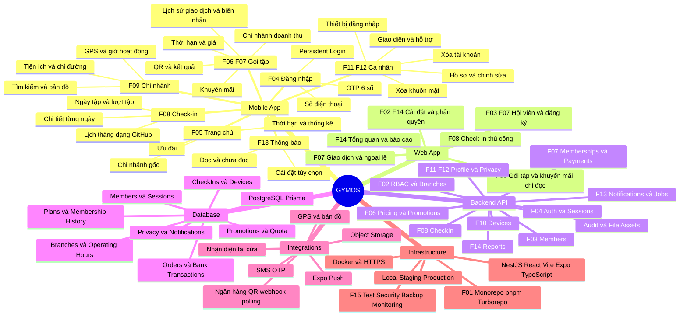

# GYMOS — Mindmap

Phiên bản dẫn xuất 0.1 · 19/11/2026 · Nguồn: [gymos.md](gymos.md) v1.0. Bản đồ phạm vi, không phải kế hoạch thực thi đã duyệt. Fxx là ID nhóm tính năng đề xuất, tra [backlog](docs/planning/FEATURE_BACKLOG.md). Các chi tiết kỹ thuật trong nguồn vẫn giữ nguyên trạng thái đã chốt/đề xuất/chưa chốt.

## Các nhánh nghiệp vụ bất biến cần giữ

- Hội viên: một tài khoản toàn chuỗi, PENDING → ACTIVE khi thanh toán lần đầu hợp lệ; SUSPENDED tách biệt với hết hạn. Chi nhánh gốc bất biến. (§2.1)
- Gói tập: một loại quyền lợi, một hạn trong `members`, tháng lịch, dùng hết ngày theo giờ Việt Nam. Không phân hạng. (§2.2)
- Giá và giao dịch: giá Backend, giảm tuần tự, giá sàn, snapshot, quota, chống cộng hạn hai lần. QR 15 phút, timestamp ngân hàng, không tiền mặt. (§2.3–2.6)
- Check-in: ACTIVE + còn hạn + chi nhánh ACTIVE + đúng giờ; thủ công online hoặc thiết bị; chỉ lưu thành công; offline thiết bị tối đa 24 giờ. Không QR check-in/check-out/occupancy. (§2.7–2.8)
- Bảo mật: OTP, phiên độc lập, thu hồi; quyền theo actor và chi nhánh; dữ liệu sinh trắc học có consent và có thể xóa riêng. (§2.9–2.11)
- UI: 5 tab Mobile; Gói tập một trang, giao dịch là trang con; nhận diện là dòng thông tin cá nhân không icon; Web chỉ vận hành chi nhánh. (§5–7)
- Ngoài phạm vi: HR, ERP, CRM tập thử, dịch vụ chuyên biệt, hạng VIP, bán tiện ích, tự đăng ký online, AI nhận diện tự xây, chat/ticket. Danh sách đầy đủ xem §1.3.

## Cách dùng

Mindmap để điều hướng, không dùng làm schema/API hoặc danh sách quyền hoàn chỉnh. Đọc mục tương ứng trong nguồn trước mỗi task. Nếu trình Markdown không hỗ trợ Mermaid, xem [FEATURE_BACKLOG.md](docs/planning/FEATURE_BACKLOG.md) dưới dạng bảng/văn bản. Không tự mở rộng vì xuất hiện một nhánh.
